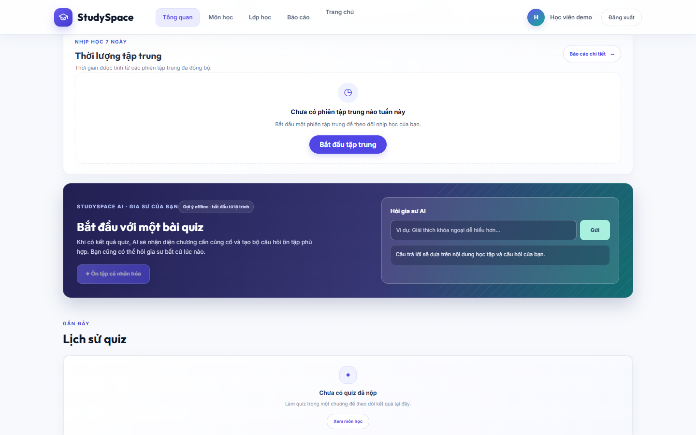
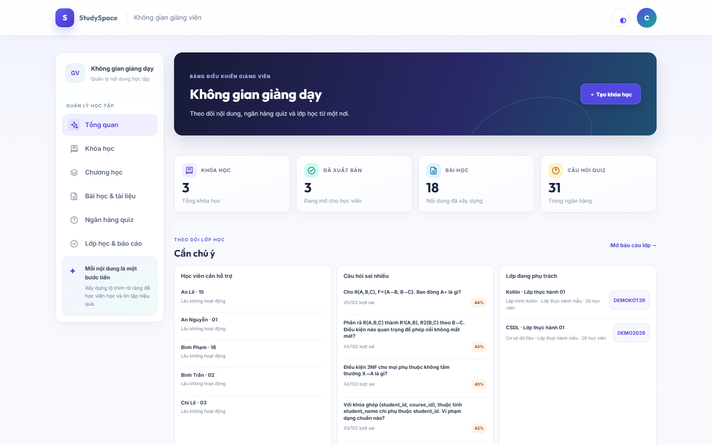
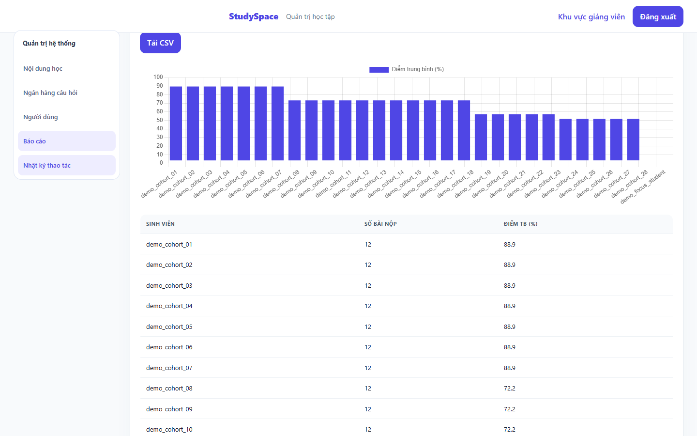

# StudySpace

**Học có lộ trình. Biết mình tiến bộ ở đâu.**

StudySpace là ứng dụng hỗ trợ học tập trực tuyến, kết nối học viên, giảng viên và quản trị viên trong một quy trình: xây dựng nội dung → học bài → làm quiz → theo dõi kết quả.

| Web app | Ứng dụng Android | Backend |
|---|---|---|
| Học viên, giảng viên, quản trị viên | Kotlin · Jetpack Compose · Room | Java · Spring Boot · REST API |

PostgreSQL lưu dữ liệu dùng chung; Room lưu kế hoạch và phiên tập trung cục bộ trên Android.

## Có gì trong StudySpace?

- **Học viên:** xem khóa học, học theo chương/bài, làm trắc nghiệm, xem câu sai và tiến độ, tham gia lớp và thảo luận.
- **Giảng viên:** tạo khóa học, chương, bài và ngân hàng câu hỏi; xuất bản nội dung; lập lớp; theo dõi báo cáo học tập.
- **Quản trị viên:** quản lý tài khoản, vai trò, nội dung và thống kê hệ thống.
- **Hỗ trợ học tập:** gợi ý ôn tập dựa trên tiến độ; có chế độ offline khi Gemini không khả dụng.

## Ảnh giao diện

| Học viên | Giảng viên | Báo cáo |
|---|---|---|
|  |  |  |

## Chạy web app trên máy mới

### Yêu cầu

- JDK 17+
- PostgreSQL 14+ đang chạy
- Windows PowerShell, hoặc shell tương đương có thể chạy Gradle Wrapper
- Android Studio/SDK chỉ cần khi build ứng dụng Android
- Gemini API key là tùy chọn

### 1. Tạo database

Trong `psql` hoặc công cụ quản trị PostgreSQL, tạo user và database. Thay mật khẩu mẫu bằng mật khẩu riêng của bạn:

```sql
CREATE USER studyspace WITH PASSWORD 'CHANGE_THIS_DATABASE_PASSWORD';
CREATE DATABASE studyspace OWNER studyspace;
```

PostgreSQL mặc định dùng cổng `5432`. Không đưa mật khẩu thật vào Git.

### 2. Cấu hình và khởi động backend

Mở PowerShell ở thư mục gốc repo. Điền thông tin DB trong biến môi trường của phiên PowerShell hiện tại:

```powershell
$env:DB_URL = 'jdbc:postgresql://localhost:5432/studyspace'
$env:DB_USER = 'studyspace'
$secure = Read-Host 'PostgreSQL password' -AsSecureString
$env:DB_PASSWORD = [Net.NetworkCredential]::new('', $secure).Password

$admin = Read-Host 'Mật khẩu admin mới (ít nhất 12 ký tự)' -AsSecureString
$env:STUDYSPACE_ADMIN_PASSWORD = [Net.NetworkCredential]::new('', $admin).Password

.\gradlew.bat -p backend installDist --no-daemon
& '.\backend\build\install\studyspace-server\bin\studyspace-server.bat' '--studyspace.seed=true'
```

Lần đầu, seed cơ bản tạo nội dung mẫu và admin local. Để thêm cohort demo, đặt `STUDYSPACE_DEMO_PASSWORD` trong phiên PowerShell rồi thêm tham số `--studyspace.seed.rich-demo=true`. Không bật seed demo trên môi trường production.

Khi backend chạy, mở:

| Trang | URL |
|---|---|
| Đăng nhập | [http://localhost:8080/login.html](http://localhost:8080/login.html) |
| Học viên | [http://localhost:8080/student.html](http://localhost:8080/student.html) |
| Giảng viên | [http://localhost:8080/teacher.html](http://localhost:8080/teacher.html) |
| Quản trị viên | [http://localhost:8080/admin.html](http://localhost:8080/admin.html) |

### Gemini (tùy chọn)

AI chạy qua backend; không nhúng key vào APK. Sao chép `.env.local.example` thành `.env.local`, đặt `GEMINI_API_KEY=` trong file local rồi khởi động lại backend. `.env.local` được Git ignore. Không gửi file này hoặc chụp màn hình có key.

Sau khi đăng nhập admin, có thể kiểm tra `/api/ai/health`. Endpoint không trả key; health probe có gọi Gemini và tiêu thụ một lượt nhỏ. Nếu chưa cấu hình hoặc dịch vụ AI không khả dụng, StudySpace vẫn có gợi ý offline từ dữ liệu học.

## Android

Build APK debug từ thư mục gốc:

```powershell
.\gradlew.bat :app:assembleDebug
```

APK được tạo tại `app/build/outputs/apk/debug/app-debug.apk`. Cài lên thiết bị đã kết nối ADB:

```powershell
adb install -r app/build/outputs/apk/debug/app-debug.apk
```

Emulator Android thường truy cập backend máy host qua `http://10.0.2.2:8080`; điện thoại thật cần dùng địa chỉ LAN của máy chạy backend và cùng mạng.

## Kiểm thử

```powershell
.\gradlew.bat :app:testDebugUnitTest --rerun-tasks
.\gradlew.bat -p backend test --rerun-tasks
```

Số liệu kiểm chứng gần nhất được ghi trong [docs/VERIFICATION.md](docs/VERIFICATION.md); đây là kết quả của lần chạy được ghi trong hồ sơ, không khẳng định đã chạy lại trên máy của bạn.

## Tài liệu đồ án

- [Hồ sơ mô tả hệ thống](docs/submission/README.md): tổng quan, ERD, use case, hướng dẫn, thiết kế giao diện và bảng đối chiếu yêu cầu.
- [Kịch bản demo](docs/DEMO_SCRIPT.md): trình tự trình diễn các vai trò.
- [Nhật ký kiểm chứng](docs/VERIFICATION.md): test, build và giới hạn xác minh.
- [Đối chiếu tính năng](docs/FEATURE_ALIGNMENT.md).

## Bảo mật và dữ liệu

Không commit `.env.local`, mật khẩu, file DPAPI, database local, keystore ký app hoặc artifacts trong `build/`. Chỉ dùng dữ liệu demo trên môi trường local; tài khoản demo không dành cho production.
