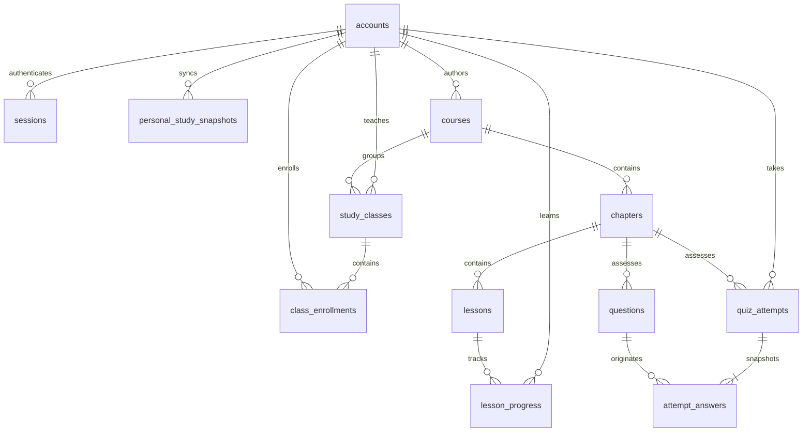
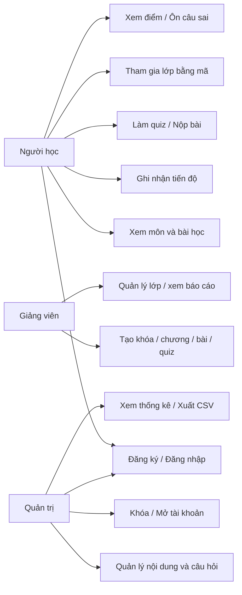

# StudySpace: hệ thống hỗ trợ học tập

Cập nhật: 2026-10-17. Trạng thái đã đối chiếu với mã nguồn, PostgreSQL local
và phiên kiểm thử web cùng ngày.

## Phạm vi hiện thực

Android Kotlin/Compose được giữ lại và hợp nhất thành bốn mục Tổng quan, Môn học, Kế hoạch, Cá nhân. Môn → chương → bài → quiz → tiến độ là luồng chính. Focus, reminder và AI hỗ trợ việc học trong cùng ứng dụng. Không còn các màn hình dashboard/planner/profile/nhóm mô phỏng song song. Đăng nhập máy chủ là luồng tài khoản duy nhất; Room lưu dữ liệu của hồ sơ đã xác thực để hỗ trợ offline. Hồ sơ local cũ được nối khi đăng nhập/đăng ký bằng cùng username và mật khẩu; app không tự chuyển dữ liệu giữa hai username khác nhau. Chi tiết tại `FEATURE_ALIGNMENT.md`.

Backend: Spring Boot, JDBC, PostgreSQL. Cổng quản trị và trang giảng viên (`/teacher.html`) được phục vụ cùng backend. Biểu đồ quản trị dùng Chart.js 4.4.8; bảng số liệu vẫn hoạt động khi CDN không truy cập được. H2 chỉ dùng cho test, không thay thế PostgreSQL khi chạy.

Đã có: tài khoản sinh viên/giảng viên/admin; admin gán role giảng viên; giảng viên tạo và quản lý khóa học của mình; CRUD chương, bài, câu hỏi; vị trí chương/bài dùng để sắp thứ tự; bài sau khóa đến khi hoàn tất bài trước; tài liệu liên kết HTTPS hoặc upload PDF/PPT/PPTX tối đa 25 MB; lớp học, mã ghi danh; tiến độ theo lớp/chương/học viên và câu hỏi sai nhiều; quiz ngẫu nhiên tối đa 10 câu, 90 giây/câu; lưu đáp án, chấm server, lịch sử và ôn câu sai; quản lý khóa tài khoản; báo cáo và CSV.

Giới hạn hiện tại: giảng viên chỉ quản lý khóa do mình tạo; khóa có sẵn do admin tạo vẫn do admin sở hữu. File upload giới hạn PDF/PPT/PPTX 25 MB; video dùng link HTTPS. File cần được backup cùng thư mục `backend/uploads`. Tài liệu mở bằng trình xem ngoài. Planner/focus có WorkManager đồng bộ nền: Room flow debounce 12 giây rồi worker one-time có initial delay 12 giây; worker định kỳ 6 giờ, yêu cầu mạng. Periodic work được enqueue khi lưu phiên sau đăng nhập/bind tài khoản. Khi phát hiện xung đột, người dùng vẫn phải chọn toàn bộ bản local hoặc server, chưa hợp nhất từng bản ghi. Đây không phải đồng bộ realtime. Chưa tự động chuyển dữ liệu giữa các tài khoản local khác username; chưa có refresh token; chưa có quiz nhiều đáp án; CSV không phải XLSX. Quiz thích ứng điều chỉnh độ khó từ tối đa ba lượt gần nhất và ưu tiên câu sai/câu chưa gặp; đây là heuristic đơn giản, chưa phải spaced repetition. Trung bình chương trong màn kết quả vẫn được tính trên toàn bộ lượt đã nộp, không phải xác suất thành thạo.

## Chạy trên Windows

Máy hiện tại dùng PostgreSQL portable vì Docker Desktop lỗi `dockerInference`. Chạy `pwsh -File backend/start-portable.ps1 -Seed`. Database ở `backend/portable/data`, chỉ lắng nghe `127.0.0.1:55432`; backend ở `http://localhost:8080`. Không cần Docker. Bộ PostgreSQL tải từ trang binary chính thức của EDB. Các bước tài khoản/app phía dưới dùng như nhau.

1. Cài/chạy Docker Desktop với Linux containers và JDK 17 trở lên.
2. Tại thư mục dự án, chạy PowerShell 7: `pwsh -File backend/start-local.ps1 -Seed`.
3. Script sinh mật khẩu ngẫu nhiên, lưu bằng Windows DPAPI trong file bị gitignore. Không đưa file đó vào báo cáo hoặc repository.
4. Mở `http://localhost:8080`. Chạy `pwsh -File backend/show-admin-login.ps1` trên máy của bạn để xem tài khoản quản trị.
5. Trên Medium Phone, đăng nhập hoặc đăng ký ngay trên màn hình đầu, rồi vào Môn học. Dùng địa chỉ `http://10.0.2.2:8080` (tên 3–80 ký tự ASCII chữ/số/._-, mật khẩu 8–72 ký tự). Không còn tài khoản đăng nhập local riêng.
6. Nếu giả lập không truy cập được loopback máy host: chạy `adb reverse tcp:8080 tcp:8080` và dùng `http://127.0.0.1:8080` trong app.

Chạy lại server sau sửa code cần dừng đúng tiến trình StudySpace (PID trong `.server.pid`) rồi chạy script lại. Dữ liệu PostgreSQL ở Docker volume `studyspace_data`; không xóa volume khi cập nhật.

Bản release yêu cầu URL HTTPS thực tế. Server mặc định chỉ bind 127.0.0.1. Khi triển khai cần reverse proxy HTTPS, cấu hình DB_PASSWORD/DB_URL/DB_USER, cơ chế backup, rate limiting cho đăng nhập và chính sách tài khoản quản trị. Không public trực tiếp server demo qua HTTP.

## Hướng dẫn sử dụng

### Người học

Vào Học tập → chọn môn → chọn bài. Đọc nội dung, mở tài liệu và chọn Đánh dấu đã học. Tiến độ bài không tự tạo phút focus.

Từ chương, chọn Làm quiz hoặc Ôn câu sai. Thời hạn bắt đầu khi server tạo lượt làm. Quay ra không dừng đồng hồ. Câu trả lời lưu bản nháp trên thiết bị và gửi lên server sau khi chọn. Mất mạng không xóa bản nháp. Khi hết giờ, chỉ đáp án đã đến server trước deadline được chấm. Mở lại bài đang làm từ lịch sử; bấm Nộp bài để xem điểm/giải thích.

Biểu tượng biểu đồ mở Kết quả học tập: chương chưa làm bài hiện Chưa đủ dữ liệu; điểm trung bình dưới 60% hiện Cần ôn thêm. Nhấn lịch sử để xem chi tiết. Nội dung đã xem được cache riêng theo tài khoản; cập nhật hoàn thành và nộp quiz cần mạng. Phiên đăng nhập được mã hóa bằng Android Keystore trước khi lưu; hết hạn hoặc đăng xuất phải đăng nhập lại.

Từ bài học có thể thêm Kế hoạch hoặc mở Focus. Đánh dấu kế hoạch hoàn thành cập nhật thống kê kế hoạch, không tạo phút học giả và không tự chấm quiz. Cá nhân có báo cáo PDF, khóa sinh trắc học, cập nhật tiến độ và thảo luận môn học dùng dữ liệu server thật.

### Đồng bộ dữ liệu cá nhân

Trong Cá nhân, chọn Đồng bộ kế hoạch và lịch sử tập trung sau khi dừng phiên focus. Room vẫn lưu dữ liệu khi mất mạng; lỗi mạng không xóa dữ liệu trên máy. Khi cả máy và server thay đổi hoặc có bản cloud chưa được nhận, app hiển thị số kế hoạch/phiên, phiên bản và thời điểm lưu để chọn bản giữ. Chọn Dùng bản trên máy chủ sẽ thay thế kế hoạch/lịch sử tập trung của tài khoản hiện tại trên thiết bị. Quiz, tiến độ bài học, tài khoản khác và điểm thưởng local không bị thay thế.

API `GET /api/personal-study` đọc bản mới nhất của chủ token. `PUT /api/personal-study` nhận `expectedVersion`, `requestId`, `data` gồm `plans` và `sessions`. Server khóa theo tài khoản, trả 409 nếu phiên bản đã thay đổi; gửi lại cùng request không nhân đôi dữ liệu. Các phiên bản được lưu trong `personal_study_snapshots` với khóa chính `(user_id, version)` và khóa ngoại tài khoản. Payload là JSON của bản dữ liệu cá nhân, không phải các bảng nội dung/quiz chuẩn hóa. Chưa có UI duyệt các phiên bản cũ hoặc chính sách dọn phiên bản.

Android khôi phục trong transaction Room, remap ID để không đụng tài khoản khác, kiểm tra dữ liệu local có đổi trong lúc chờ mạng không và cập nhật reminder theo kế hoạch nhận về. Không tạo phiên focus hoặc cộng thưởng mới vì thao tác đồng bộ.

### Quản trị nội dung

Admin đăng nhập cổng quản trị để tạo/sửa nội dung toàn hệ thống. Để giảng viên tạo nội dung riêng, admin gán role giảng viên trong mục Người dùng; giảng viên đăng nhập `/teacher.html`, tạo khóa học rồi thêm chương, bài, tài liệu và quiz. Các trường thứ tự điều khiển thứ tự hiển thị/học. Bài tiếp theo chỉ mở sau khi hoàn thành bài đứng trước. Môn chỉ xuất hiện với học viên khi được xuất bản.

Tài liệu có thể là link HTTPS hoặc tải PDF/PPT/PPTX tối đa 25 MB. Backend kiểm tra phần mở rộng và chữ ký nội dung, đổi tên file thành UUID và lưu trong `backend/uploads` (có thể đổi bằng `STUDYSPACE_UPLOAD_DIR`). Không dùng tên file do người dùng gửi làm đường dẫn lưu. Khi triển khai, cần backup thư mục này và phục vụ app qua HTTPS.

Ngân hàng câu hỏi: nhập bốn lựa chọn, đáp án đúng, giải thích và độ khó. Sửa câu hỏi không thay nội dung của các lượt quiz đã tạo vì hệ thống lưu snapshot.

Mục Người dùng cho phép khóa/mở tài khoản sinh viên; khóa sẽ thu hồi phiên. Mục Báo cáo có điểm trung bình, số lần làm và câu hỏi sai nhiều; tải CSV mở được bằng Excel. Không có dữ liệu thì không dựng số liệu giả.

## ERD

Khóa ngoại bảo toàn quan hệ. `lesson_progress` có khóa chính ghép (user_id, lesson_id). `attempt_answers` có khóa chính ghép (attempt_id, question_id), chứa snapshot đề/đáp án để giữ lịch sử khi nội dung thay đổi. Đây là dữ liệu lịch sử chủ ý, không phải lấy đáp án hiện tại để chấm đề cũ.

## Use case

## Thiết kế giao diện

- Android: Tổng quan | Môn học | Kế hoạch | Cá nhân. Focus và AI mở từ Tổng quan/bài học/kế hoạch.
- Học tập: danh sách môn + tiến độ → chương/bài/quiz → nội dung bài hoặc đề làm.
- Quiz: đồng hồ và số câu trả lời ở đầu, từng câu có radio lựa chọn, nút nộp và xác nhận ở cuối.
- Kết quả: điểm, đáp án đã chọn, đáp án đúng và giải thích.
- Web admin: thanh điều hướng Nội dung học / Ngân hàng câu hỏi / Người dùng / Báo cáo; form và danh sách thích ứng màn hình nhỏ.

## Bảo mật và kiểm thử

BCrypt cost 12 phía server. Bearer token ngẫu nhiên 256 bit, chỉ lưu SHA-256 của token trong DB, hết hạn sau 24 giờ, logout thu hồi token. SHA-256 ở đây dành cho token entropy cao, không dùng để hash mật khẩu. Student không được gọi API admin; mỗi lượt làm được kiểm tra quyền sở hữu. Đáp án đúng chỉ có trong response sau khi nộp. Server kiểm tra deadline và khóa dòng khi lưu/nộp, chống ghi đè kết quả đã nộp. Header Authorization không được ghi vào log ứng dụng.

Chạy `gradlew.bat -p backend test` kiểm tra phân quyền, giấu đáp án, quyền sở hữu, chấm bài, tính idempotent, deadline và logout. Chạy `gradlew.bat :app:testDebugUnitTest :app:assembleDebug` cho Android. CI backend riêng ở `.github/workflows/backend.yml`.

MainActivity định tuyến tới một bộ màn hình duy nhất. Biểu đồ focus và AI cũ được giữ trong StudyInsights; radar mức độ nắm vững theo chương được vẽ bằng Compose Canvas trong StudyExperienceScreens. Các màn hình trùng và luồng mô phỏng đã loại bỏ. Room lưu dữ liệu cá nhân trên thiết bị; PersonalStudySyncWorker đồng bộ theo lịch 6 giờ và sau thay đổi khi có mạng. Khi có xung đột, app yêu cầu chọn bản giữ lại; không tự hợp nhất từng bản ghi và không gọi cơ chế này là realtime.
