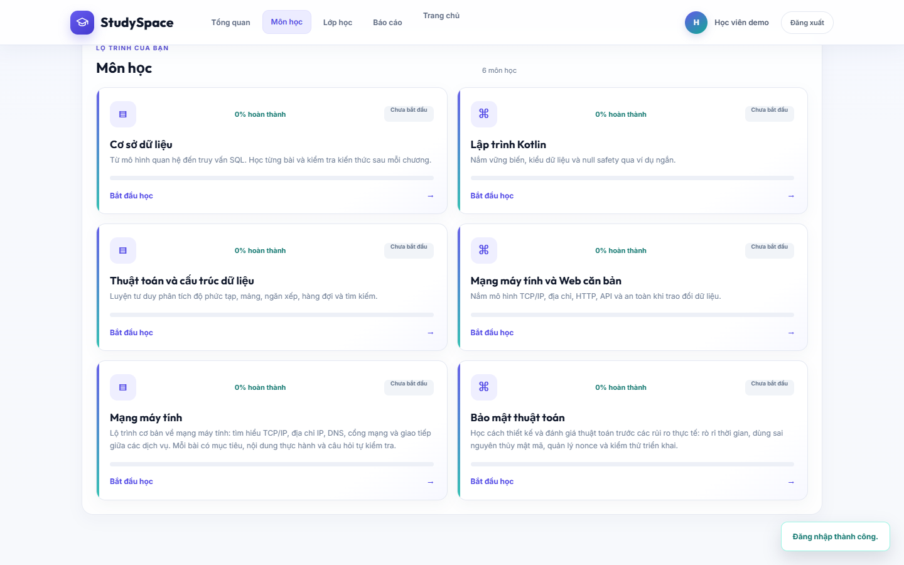

# 1. Tổng quan và kiến trúc

Cập nhật: 2026-10-19.

## Mục tiêu

StudySpace hỗ trợ người học theo một lộ trình gồm môn học, chương, bài học,
quiz và theo dõi tiến độ. Giảng viên xây dựng nội dung và lớp học; quản trị viên
quản lý tài khoản, nội dung toàn hệ thống và báo cáo.

## Thành phần

| Thành phần | Công nghệ | Trách nhiệm |
|---|---|---|
| Android | Kotlin, Jetpack Compose | Học bài, quiz, tiến độ, kế hoạch, tập trung và báo cáo cá nhân |
| Web | HTML, CSS, JavaScript | Cổng học viên, giảng viên và quản trị viên |
| Backend | Java, Spring Boot, JDBC | REST API, xác thực, phân quyền, quy tắc học tập và báo cáo |
| Cơ sở dữ liệu | PostgreSQL | Tài khoản, khóa học, bài học, quiz, tiến độ, lớp và thảo luận |
| Lưu trữ Android | Room | Kế hoạch và phiên tập trung cục bộ theo tài khoản |

## Luồng dữ liệu học tập

1. Người dùng đăng nhập; backend cấp phiên và xác định vai trò.
2. Giảng viên tạo khóa học, chương, bài học, tài liệu và câu hỏi; chỉ khóa có
   nội dung đạt điều kiện mới được xuất bản.
3. Học viên xem khóa đã xuất bản, học bài theo thứ tự và làm quiz.
4. Backend ghi tiến độ, chấm bài và cung cấp lịch sử/điểm cho báo cáo.
5. Kế hoạch và phiên tập trung được lưu trong Room và đồng bộ snapshot với
   PostgreSQL qua API cá nhân.

## Quyền theo vai trò

- **Học viên:** học khóa đã xuất bản, làm quiz, xem tiến độ, tham gia lớp và
  thảo luận.
- **Giảng viên:** quản lý khóa do mình tạo, tạo lớp, xem hoạt động học và báo
  cáo lớp.
- **Quản trị viên:** quản lý nội dung toàn hệ thống, tài khoản/vai trò và báo
  cáo tổng hợp.

## Bằng chứng giao diện

