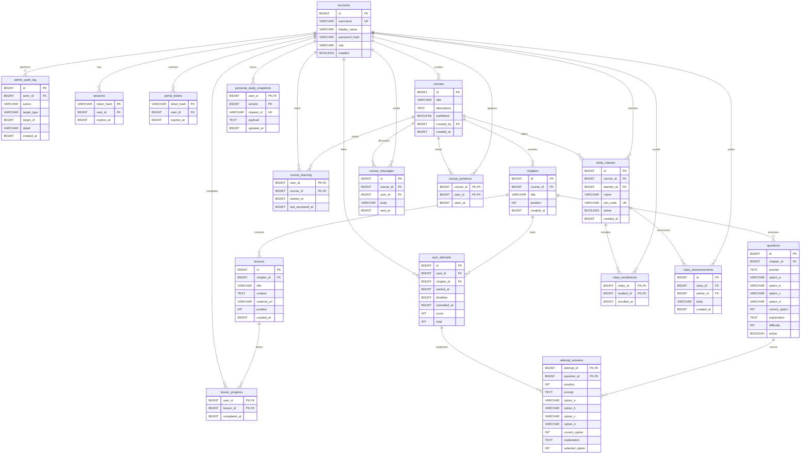
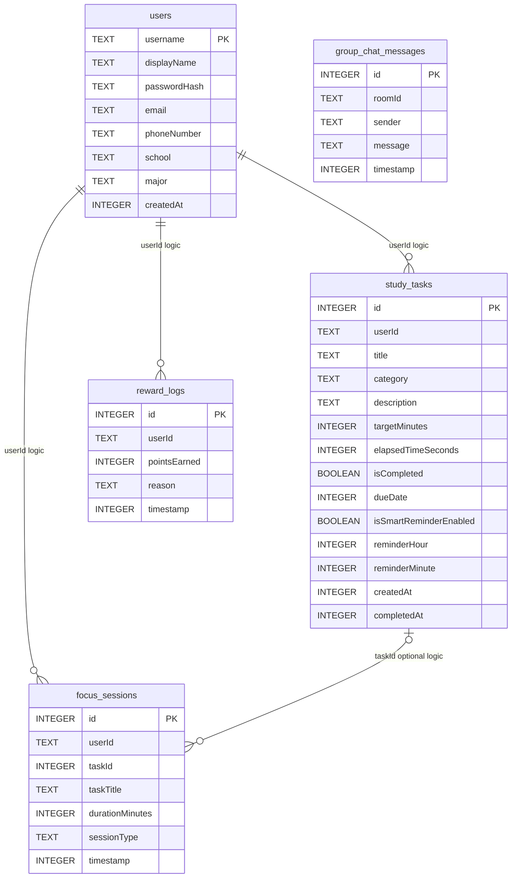
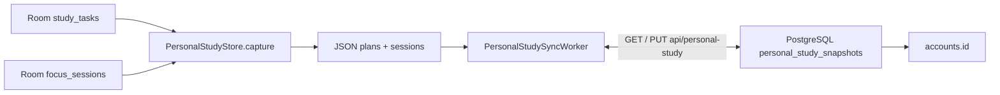

# 2. ERD và cấu trúc PostgreSQL

Cập nhật: 2026-10-19. Đối chiếu trực tiếp PostgreSQL local đang chạy tại
`127.0.0.1:55432/studyspace` qua
`information_schema.tables`, `information_schema.columns` và
`information_schema.table_constraints`.

Truy vấn ngày 2026-10-18 trả **18 bảng, 102 cột và 26 khóa ngoại**. Danh sách
bảng/cột trong Mermaid khớp live database: không thiếu và không thừa bảng/cột.
Đối chiếu số cột theo bảng:

Truy vấn có thể chạy lại trong PostgreSQL bằng `psql`:

```sql
SELECT table_name
FROM information_schema.tables
WHERE table_schema = 'public' AND table_type = 'BASE TABLE'
ORDER BY table_name;

SELECT table_name, column_name, data_type, is_nullable
FROM information_schema.columns
WHERE table_schema = 'public'
ORDER BY table_name, ordinal_position;

SELECT tc.table_name, kcu.column_name, ccu.table_name AS referenced_table,
       ccu.column_name AS referenced_column
FROM information_schema.table_constraints tc
JOIN information_schema.key_column_usage kcu
  ON tc.constraint_name = kcu.constraint_name
 AND tc.constraint_schema = kcu.constraint_schema
JOIN information_schema.constraint_column_usage ccu
  ON ccu.constraint_name = tc.constraint_name
 AND ccu.constraint_schema = tc.constraint_schema
WHERE tc.constraint_type = 'FOREIGN KEY'
  AND tc.constraint_schema = 'public'
ORDER BY tc.table_name, kcu.column_name;
```

Kết quả so sánh tên bảng/cột là **0 bảng thiếu, 0 bảng thừa, 0 cột thiếu,
0 cột thừa**; 26 cặp bảng/cột FK dưới đây khớp các cạnh trong ERD.

| Bảng | PostgreSQL | ERD | Kết quả |
|---|---:|---:|---|
| `accounts` | 6 | 6 | Khớp |
| `admin_audit_log` | 7 | 7 | Khớp |
| `attempt_answers` | 11 | 11 | Khớp |
| `chapters` | 5 | 5 | Khớp |
| `class_announcements` | 5 | 5 | Khớp |
| `class_enrollments` | 3 | 3 | Khớp |
| `course_learning` | 4 | 4 | Khớp |
| `course_messages` | 5 | 5 | Khớp |
| `course_presence` | 3 | 3 | Khớp |
| `courses` | 6 | 6 | Khớp |
| `lesson_progress` | 3 | 3 | Khớp |
| `lessons` | 7 | 7 | Khớp |
| `personal_study_snapshots` | 5 | 5 | Khớp |
| `portal_tickets` | 3 | 3 | Khớp |
| `questions` | 11 | 11 | Khớp |
| `quiz_attempts` | 8 | 8 | Khớp |
| `sessions` | 3 | 3 | Khớp |
| `study_classes` | 7 | 7 | Khớp |
| **Tổng** | **102** | **102** | **Khớp** |

Danh sách 26 quan hệ FK trong DB cũng khớp các quan hệ nối trong sơ đồ bên
dưới. Các khóa chính/duy nhất được thể hiện trong ERD; `NULL` của
`courses.created_by`, `quiz_attempts.submitted_at/score` và
`attempt_answers.selected_option` được ghi trong ghi chú/schema, không phải mọi
ký hiệu Mermaid đều biểu đạt nullability.

Các trường `created_at`
của `courses`, `chapters`, `lessons` là `BIGINT NOT NULL`, lưu epoch milliseconds.
Các bản ghi tồn tại trước migration nhận thời điểm migration làm giá trị thay
thế; đây không phải ngày tạo lịch sử.



## ERD Room Android

Room hiện có năm entity trong `app/src/main/java/com/example/data/Entities.kt`;
schema version 5 nằm trong `StudyDatabase.kt`. Room không khai báo
`ForeignKey` nào. Các mối nối `userId` và `taskId` dưới đây là tham chiếu logic
trong code, không được SQLite cưỡng chế bằng ràng buộc FK.



`GroupRoom` là model trong bộ nhớ, không phải entity Room; `roomId` của
`group_chat_messages` không có bảng phòng tương ứng trong Room.

## Ranh giới dữ liệu local và server



- `PersonalStudyStore.capture()` chỉ đóng gói `study_tasks` thành mảng
  `plans` và `focus_sessions` thành mảng `sessions`.
- Backend lưu snapshot dạng `payload TEXT`, version, request id và `user_id`;
  đây không phải các bảng server riêng cho từng kế hoạch/phiên focus.
- Snapshot gắn với `accounts.id` qua `personal_study_snapshots.user_id`; Android
  scope dữ liệu đồng bộ theo endpoint, account id và owner username.
- `users`, `reward_logs` và `group_chat_messages` không được đóng gói vào
  snapshot này. Không kết luận chúng được đồng bộ bởi WorkManager này.
- Khi restore, app thay các kế hoạch/phiên của owner trên thiết bị; `taskId` của
  phiên được ánh xạ lại sang id task mới. Xung đột version được đánh dấu để
  người dùng chọn phía cần giữ.

### Ghi chú khóa và dữ liệu

- `courses.created_by` cho phép `NULL` với khóa do hệ thống/seed tạo.
- `lesson_progress`, `course_learning`, `class_enrollments`, `course_presence`
  có khóa chính ghép theo cặp người dùng/nội dung tương ứng.
- `attempt_answers` giữ snapshot câu hỏi và đáp án để lịch sử quiz không đổi khi
  câu hỏi gốc được sửa.
- `personal_study_snapshots` dùng khóa chính `(user_id, version)` và ràng buộc
  duy nhất `(user_id, request_id)` để hỗ trợ versioning/idempotency.
- `created_at` của các hàng cũ được migration gán thời điểm chạy migration; hệ
  thống không có căn cứ để khôi phục ngày tạo lịch sử trước đó.

