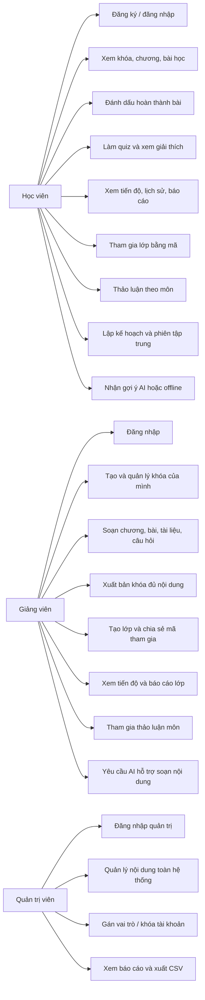

# 3. Use case theo vai trò

Cập nhật: 2026-10-19. Các ca sử dụng dưới đây được đối chiếu với API, giao diện
web và luồng Android hiện có.

## Luồng học viên

Đăng nhập → chọn khóa đã xuất bản → mở bài theo thứ tự → đánh dấu hoàn thành →
làm quiz theo chương → backend chấm và lưu lịch sử → xem điểm/đáp án/giải thích
→ theo dõi báo cáo.

## Luồng giảng viên

Đăng nhập → tạo khóa nháp → thêm chương, bài và câu hỏi → xuất bản sau khi nội
dung đạt điều kiện → tạo lớp gắn với khóa → chia sẻ mã → theo dõi tiến độ và
quiz của học viên.

## Luồng quản trị viên

Đăng nhập → quản lý nội dung dùng chung → quản lý vai trò/trạng thái tài khoản →
xem thống kê toàn hệ thống và tải CSV.

