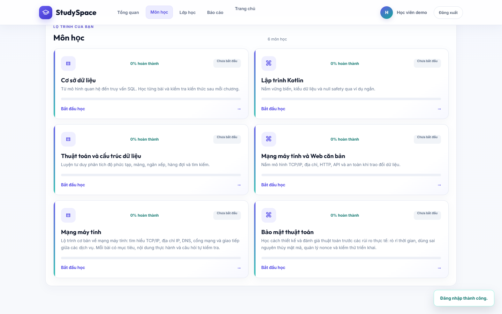
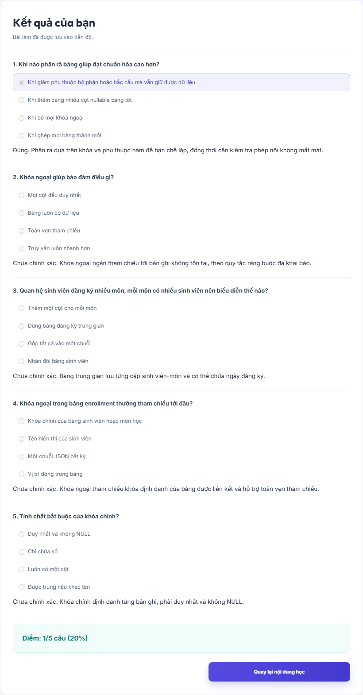
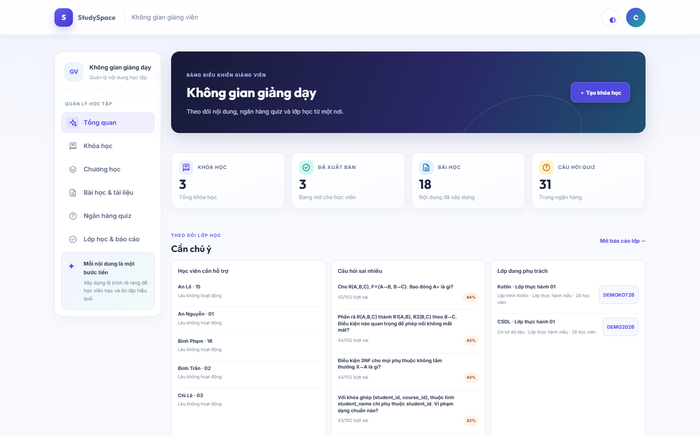
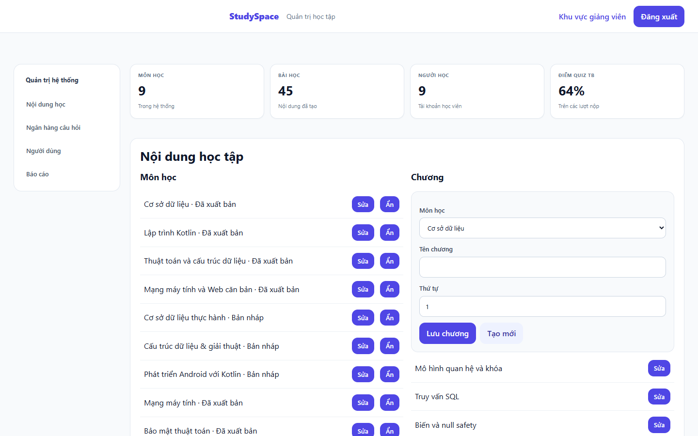

# 4. Hướng dẫn sử dụng

Cập nhật: 2026-10-19. Ảnh là ảnh giao diện web thật chụp bằng Playwright Edge
trên backend local. Username demo và trạng thái dữ liệu được ghi ở
`backend/docs/DEMO_ACCOUNTS.md`; mật khẩu không nằm trong hồ sơ nộp và không dùng
tài khoản demo trên hệ thống public.

## Học viên

1. Mở `http://localhost:8080/login.html`, đăng nhập bằng tài khoản học viên demo.
2. Chọn **Môn học** để xem 9 khóa đã xuất bản (ID 1, 2, 3, 4, 22, 23, 42, 43,
   44); các khóa 18, 19, 21 đang ẩn nhưng vẫn được lưu.
3. Chọn một khóa, mở bài đang được mở theo thứ tự; đọc nội dung/tài liệu rồi
   chọn đánh dấu hoàn thành.
4. Chọn quiz của chương, trả lời và nộp bài. Kết quả hiển thị điểm, câu trả lời
   và giải thích.
5. Vào **Lớp học**, nhập mã tham gia do giảng viên cung cấp để ghi danh và mở
   thảo luận của môn.
6. Xem **Báo cáo** để theo dõi lịch sử quiz và thời lượng focus đã đồng bộ.

## Giảng viên

1. Mở `http://localhost:8080/login.html?staff=1`, đăng nhập bằng username giảng
   viên demo. Thông tin xác thực chỉ có trong file local bị `.gitignore`.
2. Trong **Khóa học**, tạo khóa nháp và mô tả mục tiêu học tập.
3. Chọn khóa vừa tạo ở **Chương học**, thêm chương theo thứ tự.
4. Ở **Bài học & tài liệu**, chọn chương, nhập nội dung và đính kèm tài liệu
   PDF/PPT/PPTX hoặc đường dẫn HTTPS.
5. Tạo quiz trong **Ngân hàng quiz**, thêm bốn lựa chọn, đáp án và giải thích.
6. Chỉ xuất bản khi khóa đã có nội dung thật. Tạo lớp gắn với khóa và gửi mã
   tham gia cho học viên.
7. Xem **Lớp học & báo cáo** để theo dõi học viên, kết quả và thảo luận.

## Quản trị viên

1. Đăng nhập tại `http://localhost:8080/login.html?staff=1` bằng tài khoản
   admin local đã chuẩn bị. Bí mật xác thực không được ghi trong tài liệu nộp.
2. Dùng **Nội dung học**, **Ngân hàng câu hỏi**, **Người dùng** và **Báo cáo**
   để quản lý dữ liệu toàn hệ thống.
3. Gán role giảng viên cho tài khoản được chọn; quản trị viên có thể khóa/mở tài
   khoản STUDENT/TEACHER. Thao tác đổi role thu hồi phiên hiện hành.
4. Tải báo cáo CSV từ trang báo cáo.

## AI và khi mất kết nối

Trạng thái AI phải phân biệt rõ **AI trực tiếp · Gemini** với **Gợi ý offline**.
Health check local lần kiểm tra 2026-10-17 trả `not_configured`; vì vậy demo
hiện tại nên trình bày gợi ý offline và không gọi đó là phản hồi Gemini. Nếu
mạng/backend lỗi, kiểm tra lại kết nối. Gợi ý offline có thể tiếp tục ở nơi hỗ
trợ; không giả định web đã lưu nội dung hoặc cho phép làm quiz offline. Các thao
tác quiz, ghi tiến độ và thảo luận cần kết nối server.

