# 7. Thiết kế giao diện

Cập nhật: 2026-10-19. Ảnh web trong mục này là ảnh Playwright thật đã lưu trong
repo; mỗi ảnh được ghi rõ vai trò và trạng thái dữ liệu tại lúc chụp. Không dùng
ảnh web để minh họa Android. Lượt này không có thiết bị ADB nên Android ghi
**chưa có ảnh**.

## Web — học viên

| Màn hình | Ảnh | Mục đích và thành phần chính | Luồng chuyển màn |
|---|---|---|---|
| Tổng quan — khu vực nhịp học/AI | 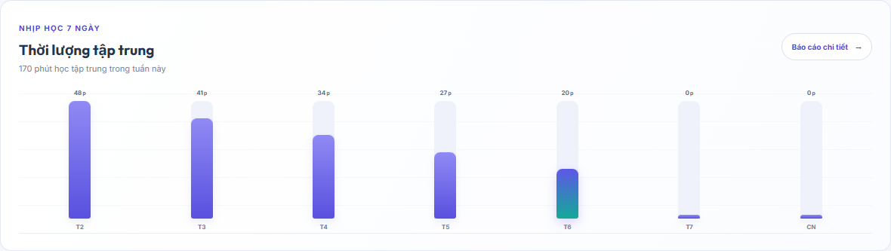 [Ảnh AI cùng trang](screenshots/student-overview-ai.png) | Tóm tắt thời lượng focus, gợi ý học/AI, lịch sử quiz. Ảnh là phần nội dung giữa/trên-dưới của trang đã cuộn, không phải toàn bộ trang. | Tổng quan → Môn học / Lớp học / Báo cáo; thẻ AI → hỏi đáp hoặc ôn tập. |
| Danh mục môn học | 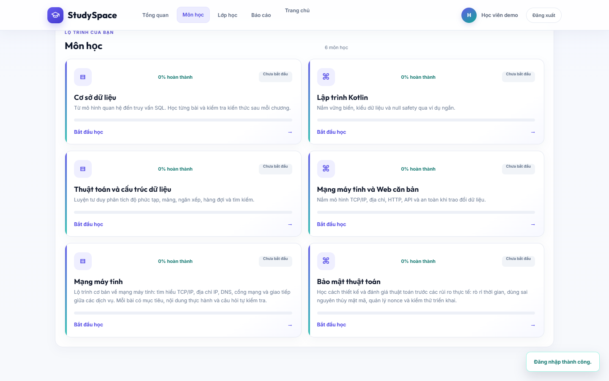 | Tìm/chọn khóa đã xuất bản; trạng thái học và tiến độ từng khóa. Ảnh chụp danh mục demo có các khóa đã xuất bản tại thời điểm kiểm tra. | Môn học → chọn khóa → chi tiết khóa. |
| Chi tiết khóa | 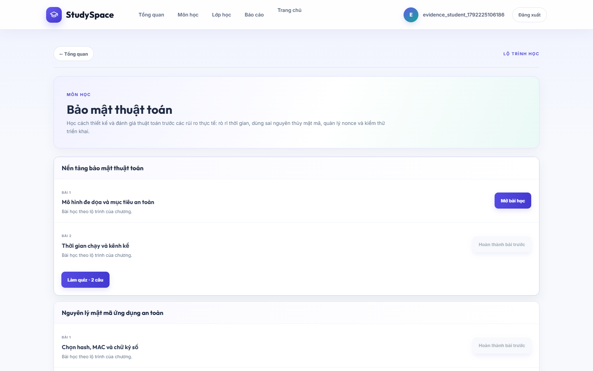 | Hiển thị chương, danh sách bài theo thứ tự, trạng thái khóa bài và nút mở bài/quiz. | Danh mục → khóa → bài học; hoàn thành bài/chương → quiz. |
| Nội dung bài học | 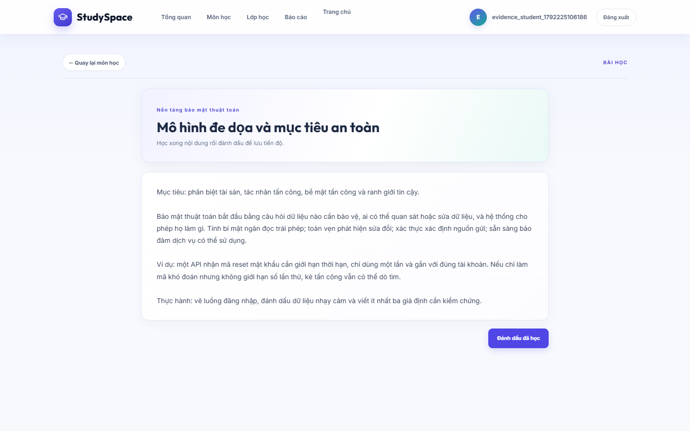 | Nội dung bài, mục tiêu học và thao tác đánh dấu đã học. | Chi tiết khóa → bài; đánh dấu hoàn thành → quay lại lộ trình/quiz chương. |
| Lớp học và thảo luận | 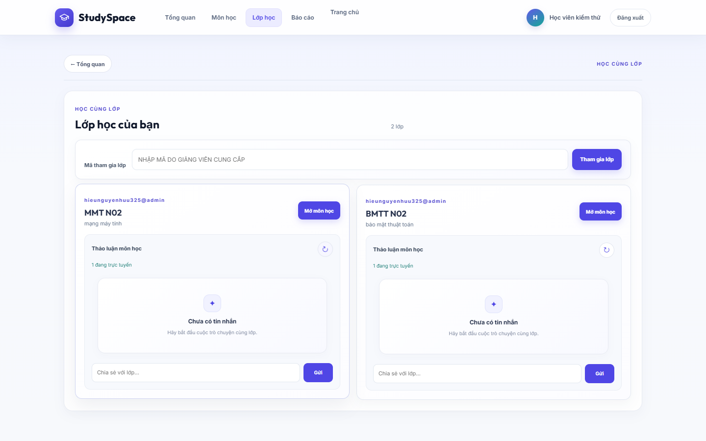 | Mã ghi danh, lớp đã tham gia, số người trực tuyến, tin nhắn và ô gửi trao đổi. | Lớp học → mở môn/lớp → thảo luận; từ lớp có thể quay lại môn học. |
| Báo cáo tiến độ | 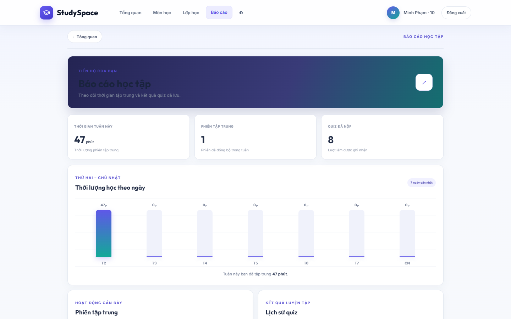 | Ảnh Playwright 1440×900 sau đăng nhập tài khoản demo: phút focus trong tuần, phiên tập trung, quiz đã nộp và lịch sử. | Menu Báo cáo → xem thời lượng, hoạt động và kết quả quiz. |
| Quiz đang làm | 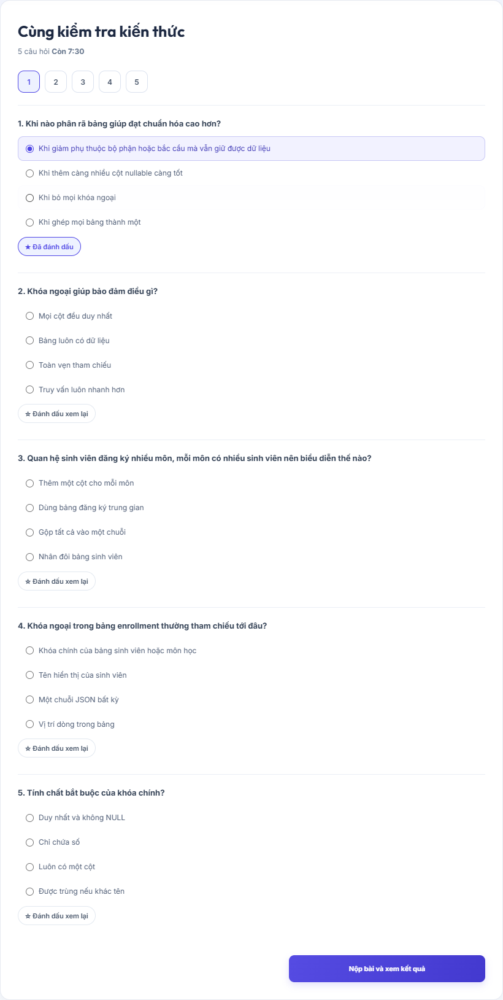 | Đồng hồ, điều hướng câu, câu trả lời và trạng thái đánh dấu xem lại; nút nộp. | Chương → bắt đầu quiz → chọn đáp án/đánh dấu → nộp → kết quả. |
| Kết quả quiz | 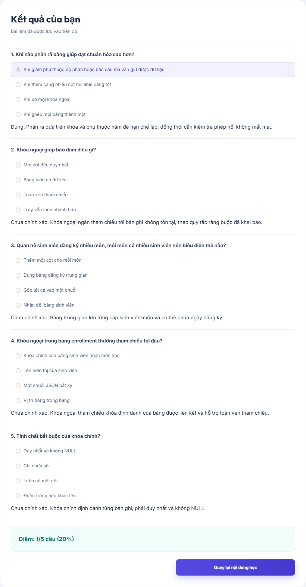 | Điểm, đáp án, giải thích từng câu và thao tác quay lại học. | Nộp quiz → kết quả → xem lại bài/ôn câu sai/báo cáo. |

## Web — giảng viên

| Màn hình | Ảnh | Mục đích và thành phần chính | Luồng chuyển màn |
|---|---|---|---|
| Không gian giảng viên — Tổng quan | 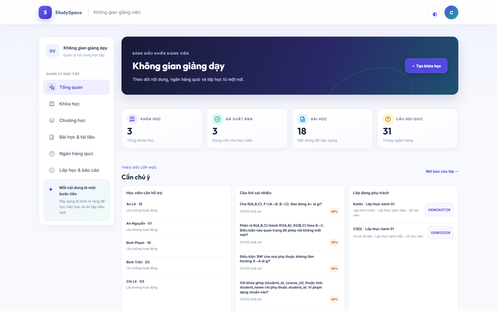 | Sidebar tác vụ và dashboard có bốn số liệu, học viên cần hỗ trợ, câu hỏi sai nhiều và lớp phụ trách. Ảnh cohort demo hiện có 3 khóa, 18 bài, 31 câu hỏi và 2 lớp. | Đăng nhập vai trò giảng viên → Tổng quan → Khóa học/Chương/Bài/Quiz/Lớp học và báo cáo. |
| Báo cáo lớp | 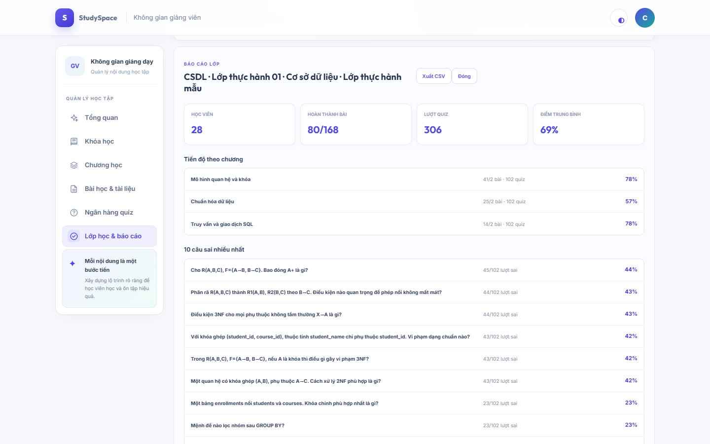 | Ảnh Playwright 1440×900: 28 học viên, tiến độ/điểm theo chương, 10 câu sai nhiều nhất, heatmap và học viên cần chú ý. Báo cáo lớp hiện dùng bảng/heatmap, không phải Chart.js. | Lớp học → chọn lớp → Báo cáo; có thể xuất CSV. |
| Trạng thái chưa có khóa | 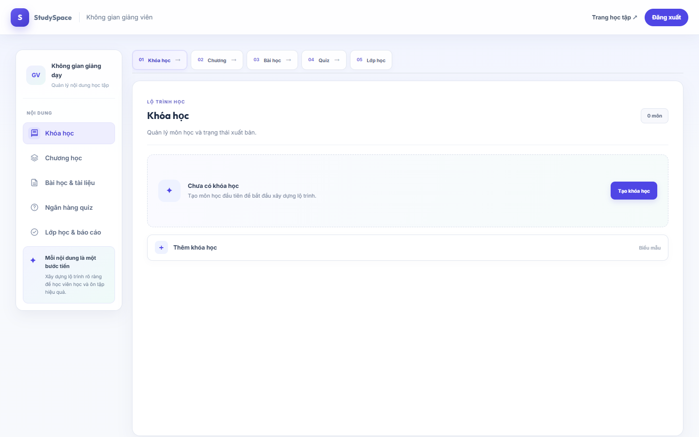 | Empty state với CTA tạo khóa; ảnh kiểm thử của tài khoản giảng viên mới, không phải dữ liệu hiện tại của demo. | Empty state → tạo khóa → sau lưu quay lại danh sách khóa. |

Các mục chương, bài, ngân hàng quiz, lớp và báo cáo được triển khai thành các
section/hash trong cùng `teacher.html`, không phải mỗi mục là một route HTML
độc lập. Ảnh minh họa hiện có tập trung vào trang quản lý khóa và empty state;
không suy diễn ảnh riêng cho các form chưa được chụp.

## Web — quản trị viên

| Màn hình | Ảnh | Mục đích và thành phần chính | Luồng chuyển màn |
|---|---|---|---|
| Dashboard quản trị | 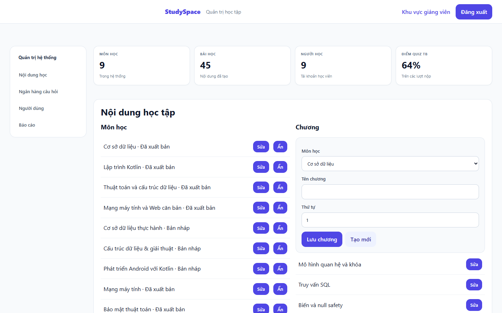 | Điều hướng nội dung, câu hỏi, người dùng và báo cáo; các số tổng quan; danh sách khóa/chương và biểu mẫu quản trị đang được chọn. Ảnh là snapshot dữ liệu tại thời điểm chụp. | Đăng nhập admin → nội dung/ngân hàng câu hỏi/người dùng/báo cáo → thao tác quản trị hoặc tải CSV. |
| Báo cáo có biểu đồ Chart.js | 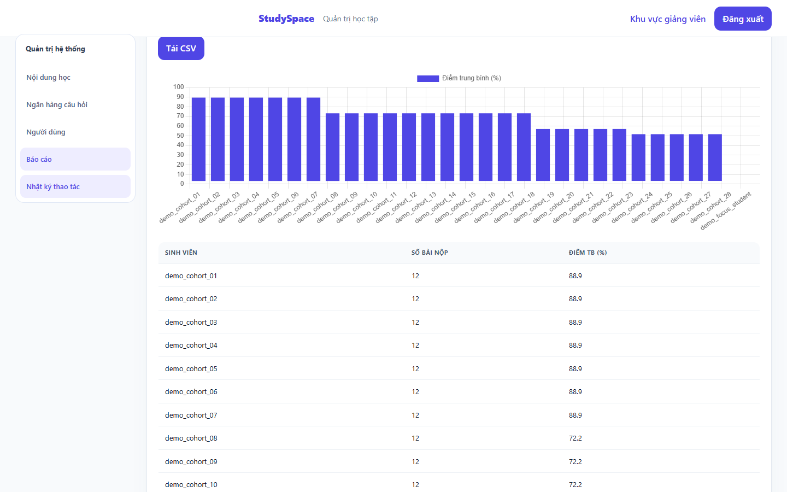 | Ảnh Playwright 1440×900 của mục Báo cáo admin; biểu đồ cột điểm trung bình học viên được render bởi Chart.js. | Admin → Báo cáo; có bảng kết quả và tải CSV. |

Các mục quản trị được đổi trong cùng trang `admin.html`; ảnh hiện có là ảnh
dashboard chụp thật, không phải ảnh mô phỏng riêng cho từng mục con.

## Android — Kotlin/Compose

**Chưa kiểm tra trực quan APK hiện tại trên thiết bị.** APK debug có trong gói
nộp và Android unit test hiện tại PASS 56/56; ADB không có thiết bị được kết
nối trong lượt kiểm tra. Không dùng ảnh Android cũ ở thư mục gốc làm bằng chứng
cho APK hiện tại.

| Màn hình | Ảnh | Mục đích/thành phần và luồng theo mã nguồn |
|---|---|---|
| Đăng nhập/đăng ký | **Chưa có ảnh Android.** | Xác thực và cấu hình kết nối; sau đăng nhập vào Tổng quan. Composable tại `app/src/main/java/com/example/learning/ProductScreens.kt`. |
| Tổng quan | **Chưa có ảnh Android.** | Tiếp tục học, gợi ý AI, chỉ số tiến độ và điều hướng sang Môn học/Kế hoạch/Cá nhân. `LearningHome` trong `ProductScreens.kt`. |
| Danh mục → khóa → bài → quiz | **Chưa có ảnh Android.** | Danh mục khóa, lộ trình chương/bài, nội dung bài, quiz và kết quả. `LearningScreen`, `CourseCatalog`, `CourseScreen`, `LessonScreen`, `QuizScreen` trong `LearningScreen.kt`. |
| Kế hoạch và mục tiêu | **Chưa có ảnh Android.** | Danh sách việc học, tạo/sửa mục tiêu và trạng thái hoàn thành. `StudyPlanScreen` ở `ProductScreens.kt`, mục tiêu ở `StudyExperienceScreens.kt`. |
| Focus | **Chưa có ảnh Android.** | Phiên tập trung/nghỉ, thời gian còn lại và liên kết mục tiêu; `FocusScreen.kt`. |
| Báo cáo và radar | **Chưa có ảnh Android.** | Thống kê tiến độ/quiz, biểu đồ và `MasteryRadar`; `ProductReportsScreen` trong `StudyExperienceScreens.kt`. |
| Hồ sơ | **Chưa có ảnh Android.** | Thông tin tài khoản và thiết lập; `ProductAccount` trong `ProductScreens.kt`. |

## Nguồn ảnh và giới hạn

Ảnh web được lấy từ `docs/submission/screenshots/` hoặc bộ bằng chứng
Playwright đã lưu tại `backend/docs/test-evidence/`. Chúng ghi lại giao diện
trình duyệt ở kích thước desktop; không đại diện cho responsive mọi kích thước,
không chứng minh API live bên ngoài và không thay thế ảnh chụp Android.
